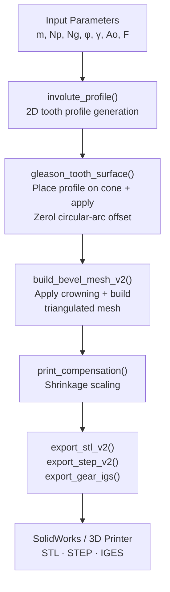

# Zerol Bevel Gear Design — Wind Turbine Pitch Control System

## Complete Technical Documentation

**Author:** Ahmed Majdy Ahmed  
**Date:** 2026-08-26  
**Project:** Wind Turbine Blade Pitch Control Mechanism  
**Software:** MATLAB R2024b → SolidWorks / 3D Printer  

---

## Table of Contents

1. [System Overview](#1-system-overview)
2. [Drivetrain Architecture](#2-drivetrain-architecture)
3. [Design Parameters](#3-design-parameters)
4. [Gleason Bevel Gear Theory](#4-gleason-bevel-gear-theory)
5. [Derived Geometry Calculations](#5-derived-geometry-calculations)
6. [True Cone Projection — The Critical Fix](#6-true-cone-projection--the-critical-fix)
7. [3D Mesh Generation Pipeline](#7-3d-mesh-generation-pipeline)
8. [3D Print Compensation](#8-3d-print-compensation)
9. [Stress Analysis & Safety Factors](#9-stress-analysis--safety-factors)
10. [Export Pipeline](#10-export-pipeline)
11. [Project File Structure](#11-project-file-structure)
12. [Design Evolution & Revision History](#12-design-evolution--revision-history)
13. [How to Modify Parameters](#13-how-to-modify-parameters)
14. [Final Design Summary](#14-final-design-summary)

---

## 1. System Overview

This project implements a **Zerol bevel gear pair** for controlling the **blade pitch angle** of a small wind turbine. The gear system converts rotary motion from a central motor-driven ring gear into angular rotation of individual blade pitch shafts.

### What is a Zerol Bevel Gear?

A **Zerol bevel gear** is a specific type of bevel gear manufactured using the **Gleason face-milling process**. Key characteristics:

- **Spiral angle = 0°** at the mean cone distance (hence "Zerol" = Zero + Spiral)
- Teeth follow a **circular arc** on the pitch cone surface (not straight lines)
- Produces **smoother meshing** than straight bevel gears
- **No axial thrust** at nominal load (unlike spiral bevel gears with 25–35° spiral angle)
- Manufactured with a face-milling cutter of radius ≈ mean cone distance

Unlike straight bevel gears (straight teeth when viewed from above) or spiral bevel gears (angled teeth), Zerol gears have **visibly curved teeth that point directly toward the cone apex**.

### Why Zerol for This Application?

| Requirement | Why Zerol Works |
|---|---|
| Low axial load on blade bearings | Zero spiral angle → no axial thrust |
| Smooth pitch adjustment | Curved teeth → gradual engagement |
| 3D printable prototype | Simpler contact pattern than spiral |
| 90° shaft angle | Standard bevel gear configuration |

---

## 2. Drivetrain Architecture

```
Motor → Worm Gearbox → Central Ring Gear (48T, Driver)
                          ├──→ Zerol Pinion #1 (16T) → Blade 1 Pitch Shaft
                          ├──→ Zerol Pinion #2 (16T) → Blade 2 Pitch Shaft
                          └──→ Zerol Pinion #3 (16T) → Blade 3 Pitch Shaft
```

### Configuration

- **3 pinions** spaced 120° apart around the ring gear
- Each pinion drives one blade's pitch shaft
- The ring gear is the **driver** (input); pinions are **driven** (output)
- **Gear ratio:** 1:3 (ring gear to each pinion)
- **Shaft angle:** 90° (ring gear axis ⊥ pinion axes)

### Kinematics

| Parameter | Formula | Value |
|---|---|---|
| Ring gear speed | Input | 100 RPM |
| Pinion speed | `n_ring × (Ng/Np)` | 300 RPM |
| Torque per mesh | `T_ring / n_pinions` | 6.67 N·m |
| Torque per pinion | `(T_mesh / i_ratio) × η` | 2.16 N·m |
| Total input power | `T_ring × 2π × n_ring / 60` | 209.4 W |

---

## 3. Design Parameters

All parameters are defined in the **INPUT PARAMETERS** section of [`zerol_bevel_design_v2.m`](file:///c:/Users/thepr/Desktop/Wind%20Turbine/Pitch%20Control%20System/Gear%20Design/Matlab_Zerol_Bevel/zerol_bevel_design_v2.m#L33-L75):

### 3.1 Gear Tooth Parameters

| Parameter | Symbol | Value | Description |
|---|---|---|---|
| Module | `m` | **3.0 mm** | Fundamental tooth size parameter |
| Pinion teeth | `Np` | **16** | Number of teeth on the pinion |
| Gear teeth | `Ng` | **48** | Number of teeth on the ring gear |
| Pressure angle | `φ` | **20°** | Standard Gleason value |
| Shaft angle | `Σ` | **90°** | Perpendicular shafts |
| Gear ratio | `i` | **1:3** | `Ng / Np = 48 / 16` |

### 3.2 Pitch Diameters

$$d_p = m \times N_p = 3.0 \times 16 = 48.00 \text{ mm}$$

$$d_g = m \times N_g = 3.0 \times 48 = 144.00 \text{ mm}$$

### 3.3 Tooth Depth Factors (Gleason Standard)

| Parameter | Symbol | Formula | Value |
|---|---|---|---|
| Working depth factor | `khw` | — | 2.00 |
| Clearance factor | `c_f` | — | 0.188 |
| Working depth | `hw` | `khw × m` | **6.000 mm** |
| Clearance | `c` | `c_f × m` | **0.564 mm** |
| Whole depth | `ht` | `hw + c` | **6.564 mm** |

### 3.4 Gleason Unequal Addendum System

Gleason bevel gears use an **unequal addendum split** (60/40) to avoid undercutting on the pinion and balance sliding velocities:

| Parameter | Pinion | Gear | Formula |
|---|---|---|---|
| Addendum | **3.600 mm** | **2.400 mm** | `0.60 × hw` / `0.40 × hw` |
| Dedendum | **2.964 mm** | **4.164 mm** | `ht − addendum` |

> [!IMPORTANT]
> The pinion gets the **larger addendum** (60%) to compensate for its smaller number of teeth. This prevents undercutting and balances the specific sliding between pinion and gear.

### 3.5 Tooth Thickness (Gleason Balance)

| Parameter | Formula | Pinion | Gear |
|---|---|---|---|
| Nominal | `π × m / 2` | 4.712 mm | 4.712 mm |
| Shift | `0.180 × m` | +0.540 mm | −0.540 mm |
| **Final** | `nom ± shift` | **5.252 mm** | **4.172 mm** |

The pinion tooth is **thickened** and the gear tooth is **thinned** to balance bending strength between the two members.

### 3.6 Multi-Pinion Configuration

```
n_pinions = 3    →    120° spacing around ring gear
```

With 48 teeth on the ring gear: `48 / 3 = 16 teeth per sector`, giving perfect 120° symmetry.

### 3.7 Cutter Parameters

```
r_cutter = [] → auto = Am (mean cone distance) = 65.3 mm
```

The cutter radius controls the curvature of the tooth trace on the pitch cone. Setting it to the mean cone distance is the standard Gleason practice. A larger radius gives straighter-looking teeth; `Inf` gives a straight bevel.

### 3.8 Mesh Resolution

| Parameter | Value | Purpose |
|---|---|---|
| `n_inv` | 20 | Points per involute curve |
| `n_sec` | 16 | Cross-sections along face width |
| `n_top` | 4 | Points on tip land arc |
| `n_root` | 4 | Points on root land arc |

**Total vertices per gear:**
- Pinion: `n_sec × (Np × (2×n_inv + n_top + n_root))` = 14,336
- Gear: `n_sec × (Ng × (2×n_inv + n_top + n_root))` = 36,864 (estimated)

---

## 4. Gleason Bevel Gear Theory

### 4.1 Pitch Cone Geometry

For a 90° shaft angle (`Σ = 90°`), the pitch cone angles are:

$$\gamma_p = \arctan\left(\frac{\sin\Sigma}{N_g/N_p + \cos\Sigma}\right) = \arctan\left(\frac{1}{3}\right) = 18.43°$$

$$\gamma_g = \Sigma - \gamma_p = 90° - 18.43° = 71.57°$$

### 4.2 Cone Distances

| Parameter | Formula | Value |
|---|---|---|
| Outer cone distance | `Ao = dp / (2 × sin(γ_p))` | **75.89 mm** |
| Face width | `F = 0.28 × Ao` | **21.25 mm** |
| Mean cone distance | `Am = Ao − F/2` | **65.27 mm** |
| Inner cone distance | `Ai = Ao − F` | **54.64 mm** |

### 4.3 Tregold's Approximation (Virtual Teeth)

To apply spur gear involute theory to bevel gears, we use **Tregold's approximation** — the tooth profile is computed in the **back-cone plane** using virtual spur gear teeth:

$$N_{v,p} = \frac{N_p}{\cos\gamma_p} = \frac{16}{\cos 18.43°} = 16.88$$

$$N_{v,g} = \frac{N_g}{\cos\gamma_g} = \frac{48}{\cos 71.57°} = 151.79$$

### 4.4 Contact Ratio

Using the virtual tooth geometry:

$$CR = \frac{\sqrt{r_{av,p}^2 - r_{bv,p}^2} + \sqrt{r_{av,g}^2 - r_{bv,g}^2} - (r_{v,p} + r_{v,g})\sin\phi}{\pi m \cos\phi}$$

$$CR = 1.642 \quad \text{(GOOD — target ≥ 1.2)}$$

A contact ratio of 1.642 means that **on average, 1.6 tooth pairs are in contact** at any instant, ensuring smooth load transfer.

### 4.5 Zerol Tooth Trace (Circular Arc)

The defining feature of a Zerol bevel gear is the tooth trace. At each cone distance `A` along the face width:

$$\Delta\theta = -\frac{r_c - \sqrt{r_c^2 - (A - A_m)^2}}{A \sin\gamma}$$

Where:
- `r_c` = cutter radius (65.3 mm)
- `A_m` = mean cone distance (65.27 mm)
- `γ` = pitch cone angle

At `A = A_m`, the offset `Δθ = 0` (spiral angle = 0°). As `A` moves toward the toe or heel, the offset creates the characteristic curved tooth trace.

---

## 5. Derived Geometry Calculations

Computed in [`zerol_bevel_design_v2.m`](file:///c:/Users/thepr/Desktop/Wind%20Turbine/Pitch%20Control%20System/Gear%20Design/Matlab_Zerol_Bevel/zerol_bevel_design_v2.m#L77-L150) lines 77–150:

### 5.1 Outside Diameters

$$D_{o,p} = d_p + 2 \times a_p \times \cos\gamma_p = 48 + 2 \times 3.6 \times \cos18.43° = 54.83 \text{ mm}$$

$$D_{o,g} = d_g + 2 \times a_g \times \cos\gamma_g = 144 + 2 \times 2.4 \times \cos71.57° = 145.52 \text{ mm}$$

### 5.2 Mounting Distances

$$MD_p = A_o \cos\gamma_p - a_p \sin\gamma_p = 70.86 \text{ mm}$$

$$MD_g = A_o \cos\gamma_g - a_g \sin\gamma_g = 21.72 \text{ mm}$$

> [!NOTE]
> Mounting distance is the axial distance from the pitch cone apex to the back face of the gear. It is critical for assembly — incorrect mounting distance causes the contact pattern to shift toward the toe or heel.

---

## 6. True Cone Projection — The Critical Fix

> [!CAUTION]
> This section documents the most important change in the design. The original code had a **fundamental geometry error** that caused teeth to appear far too shallow in 3D prints.

### 6.1 The Problem (Old Code)

The original [`gleason_tooth_surface.m`](file:///c:/Users/thepr/Desktop/Wind%20Turbine/Pitch%20Control%20System/Gear%20Design/Matlab_Zerol_Bevel/Core/gleason_tooth_surface.m) generated the gear as a **stack of flat 2D involute profiles** at different Z heights:

```matlab
% OLD CODE (WRONG):
x = r × cos(θ)      % r from 2D involute profile
y = r × sin(θ)
z = A × cos(γ)       % flat plane at height z
```

This created a **cylindrical** gear with linearly scaled cross-sections — NOT a true bevel gear cone. The addendum and dedendum were measured **radially in the XY plane**, not perpendicular to the cone surface.

**The visual consequence:**

For the ring gear with cone angle `γ_g = 71.57°`:
- The tooth height was projected onto the XY plane
- Visual depth ≈ `actual_depth × cos(γ_g)` = `6.564 × cos(71.57°)` ≈ **2.07 mm**
- Teeth appeared **less than 1/3 as deep** as the designed 6.564 mm

```
Side view comparison:

OLD (flat stack):           NEW (true cone):
                            
    ┌─┐ ┌─┐ ┌─┐               /│\ /│\ /│\
    │ │ │ │ │ │              / │ X │ X │ \
    │ │ │ │ │ │             /  │/ \│/ \│  \
    └─┘ └─┘ └─┘           /   └───┴───┘   \
    ───────────           ─────────────────── 
    Teeth on flat Z       Teeth normal to cone
    (shallow appearance)  (correct depth)
```

### 6.2 The Fix (New Code)

The rewritten code places each profile point **on the pitch cone surface** and projects the addendum/dedendum **normal to the cone surface**:

```matlab
% NEW CODE (CORRECT):
% For each point in the 2D involute profile:
delta_r = r_profile - r_pitch_local;    % deviation from pitch circle

% Project onto cone:
r_3d = r_cone + delta_r × cos(γ);      % radial component
z_3d = z_cone − delta_r × sin(γ);      % axial component

% Convert to Cartesian:
x = r_3d × cos(θ)
y = r_3d × sin(θ)
z = z_3d
```

Where:
- `r_cone = A × sin(γ)` — radial position of pitch point on cone surface
- `z_cone = A × cos(γ)` — axial position of pitch point on cone surface
- `delta_r > 0` — point is in the addendum (tooth tip, extends outward from cone)
- `delta_r < 0` — point is in the dedendum (tooth root, extends inward into cone)

### 6.3 Mathematical Derivation

The pitch cone surface at cone distance `A` and cone angle `γ` has:

$$\vec{P}_{pitch} = \begin{pmatrix} A\sin\gamma \cos\theta \\ A\sin\gamma \sin\theta \\ A\cos\gamma \end{pmatrix}$$

The **outward cone normal** at this point (perpendicular to the cone surface, pointing away from the solid body) is:

$$\hat{n} = \begin{pmatrix} \cos\gamma \cos\theta \\ \cos\gamma \sin\theta \\ -\sin\gamma \end{pmatrix}$$

A point at involute radius `r = r_{pitch} + \Delta r` is displaced from the pitch cone by:

$$\vec{P}_{3D} = \vec{P}_{pitch} + \Delta r \cdot \hat{n}$$

Expanding:

$$r_{3D} = A\sin\gamma + \Delta r \cos\gamma$$
$$z_{3D} = A\cos\gamma - \Delta r \sin\gamma$$

This is exactly what the new code computes.

### 6.4 Impact on Both Gears

| Gear | Cone Angle γ | cos(γ) | Old Visual Depth | New Visual Depth |
|---|---|---|---|---|
| **Pinion** | 18.43° | 0.949 | ~6.2 mm (5% error) | **6.564 mm** (correct) |
| **Ring gear** | 71.57° | 0.316 | ~2.1 mm (68% error!) | **6.564 mm** (correct) |

> [!WARNING]
> The pinion was only slightly affected (5% foreshortening) because its cone angle is shallow (18.43°). The ring gear was **catastrophically wrong** — the teeth appeared only 1/3 of their actual depth because its cone angle is steep (71.57°).

---

## 7. 3D Mesh Generation Pipeline

### 7.1 Pipeline Overview



### 7.2 Step 1: 2D Involute Profile Generation

**Function:** `involute_profile()` inside [`gleason_tooth_surface.m`](file:///c:/Users/thepr/Desktop/Wind%20Turbine/Pitch%20Control%20System/Gear%20Design/Matlab_Zerol_Bevel/Core/gleason_tooth_surface.m#L115-L209)

Generates a complete 2D gear profile (all N teeth) in the back-cone plane:

1. **Compute key radii:**
   - Pitch radius: `r_p = m × N / 2`
   - Base circle: `r_b = r_p × cos(φ)`
   - Tip radius: `r_a = r_p + addendum`
   - Root radius: `r_d = max(r_p − dedendum, 0.3 × r_b)` (floor prevents negative radius)

2. **Build one tooth profile** (counterclockwise):
   - **Left flank:** Involute curve from root to tip (+ straight radial segment if root < base circle)
   - **Tip land:** Circular arc at `r = r_a` connecting left and right flanks
   - **Right flank:** Mirror involute curve from tip back to root
   - **Root land:** Circular arc at `r = r_d` connecting to the next tooth

3. **Replicate** the single-tooth profile N times around 360°

**Points per tooth:** `2 × n_inv + n_top + n_root` = `2×20 + 4 + 4` = **48 points**  
**Total points per profile:** `48 × N`

### 7.3 Step 2: Cone Placement + Zerol Tooth Trace

**Function:** `gleason_tooth_surface()` in [`gleason_tooth_surface.m`](file:///c:/Users/thepr/Desktop/Wind%20Turbine/Pitch%20Control%20System/Gear%20Design/Matlab_Zerol_Bevel/Core/gleason_tooth_surface.m#L1-L113)

For each of the `n_sec = 16` cross-sections along the face width:

1. **Compute cone distance:** `A = linspace(Ai, Ao, n_sec)`
2. **Scale factor:** `sf = A / Ao` (teeth shrink toward cone apex)
3. **Scale the 2D profile:** `scaled_radii = ref_radii × sf`
4. **Compute Zerol angular offset:** `Δθ` from the circular-arc tooth trace formula
5. **Project onto cone surface:**
   ```
   delta_r = scaled_radii − r_pitch_local
   r_3d = A×sin(γ) + delta_r × cos(γ)
   z_3d = A×cos(γ) − delta_r × sin(γ)
   ```
6. **Convert to Cartesian:** `x = r_3d × cos(θ+Δθ)`, `y = r_3d × sin(θ+Δθ)`, `z = z_3d`

**Output:** A matrix of 3D vertices, `n_sec × M` points, where `M` = points per cross-section.

### 7.4 Step 3: Mesh Construction + Crowning

**Function:** [`build_bevel_mesh_v2()`](file:///c:/Users/thepr/Desktop/Wind%20Turbine/Pitch%20Control%20System/Gear%20Design/Matlab_Zerol_Bevel/Core/build_bevel_mesh_v2.m)

#### Crowning Modifications

Applied to the 3D vertices along the **cone-normal direction**:

| Crowning Type | Formula | Purpose |
|---|---|---|
| **Lengthwise** | `δ_L = C_L × t²` where `t ∈ [−1, 1]` toe→heel | Parabolic inward at toe/heel for contact localization |
| **Profile** | `δ_P = C_P × (2h−1)²` where `h ∈ [0,1]` root→tip | Parabolic along tooth height |
| **Tip relief** | Linear from `tip_start` to tip | Prevents tip interference |

Default values for PLA:
- Lengthwise crown: 0.012 mm
- Profile crown: 0.008 mm
- Tip relief: 0.10 mm (starting at 85% of addendum)

#### Lateral Face Construction

Connects adjacent cross-sections with quad faces, each split into 2 triangles:

```
Section s:     v1 ─── v2        v1–v2–v3 (triangle 1)
               │ \    │        v1–v3–v4 (triangle 2)
Section s+1:   v4 ─── v3
```

Total lateral faces: `2 × (n_sec − 1) × M`

#### End Cap Construction

Uses MATLAB's `polyshape` + `triangulation` for **exact 2D planar polygon triangulation**:

1. Extract the 2D (x, y) boundary of the inner/outer cross-section
2. Create a `polyshape` object
3. Triangulate using `triangulation(pgon)`
4. Map triangulation vertices back to mesh vertex indices
5. Orient normals: inner cap faces toward cone apex, outer cap faces away

> [!NOTE]
> An earlier version used a **center-fan** approach (connecting all contour points to the axis center). This created visible **spoke/spiderweb artifacts** in SolidWorks because the triangles spanned from the tooth tips to the center. The polyshape triangulation produces clean, flat end caps.

#### Mesh Validation

- **Degenerate triangle removal:** Triangles with area < 10⁻¹⁰ mm² are removed
- **Euler characteristic check:** `V − E + F = 2` for a watertight mesh

### 7.5 Step 4: Print Compensation

**Function:** [`print_compensation()`](file:///c:/Users/thepr/Desktop/Wind%20Turbine/Pitch%20Control%20System/Gear%20Design/Matlab_Zerol_Bevel/PrintComp/print_compensation.m)

Uniform scaling from the mesh centroid:

```matlab
centroid = mean(vertices, 1);
vertices_out = (vertices − centroid) × shrinkage_factor + centroid;
```

For PLA: `shrinkage_factor = 1.003` (0.3% expansion to compensate for 0.3% shrinkage during cooling).

---

## 8. 3D Print Compensation

### 8.1 Material Settings

**Function:** [`print_settings()`](file:///c:/Users/thepr/Desktop/Wind%20Turbine/Pitch%20Control%20System/Gear%20Design/Matlab_Zerol_Bevel/PrintComp/print_settings.m)

| Setting | PLA | ABS | PETG | Nylon | Resin | Steel |
|---|---|---|---|---|---|---|
| Shrinkage | 0.3% | 0.6% | 0.4% | 1.5% | 0.2% | 0% |
| Backlash | 0.15 mm | 0.20 mm | 0.15 mm | 0.25 mm | 0.08 mm | 0.02 mm |
| Tip relief | 0.10 mm | 0.12 mm | 0.10 mm | 0.15 mm | 0.05 mm | 0.02 mm |
| Min wall | 1.2 mm | 1.5 mm | 1.2 mm | 1.5 mm | 0.8 mm | — |
| Tolerance | ±0.15 | ±0.20 | ±0.15 | ±0.25 | ±0.05 | ±0.02 |

### 8.2 Compensation Applied

For the current design (PLA):

| Compensation | Formula | Value |
|---|---|---|
| Tooth thickness (print) | `s − extra_backlash` | Pinion: 5.102 mm, Gear: 4.022 mm |
| Clearance (print) | `c_std + clearance_add` | 0.664 mm |
| Whole depth (print) | `hw + c_print` | 6.664 mm |
| Dedendum (print) | `ht_print − addendum` | Pinion: 3.064 mm, Gear: 4.264 mm |
| Shrinkage scale | uniform | ×1.003 |

---

## 9. Stress Analysis & Safety Factors

### 9.1 Forces at Mean Cone Distance

| Force | Formula | Value |
|---|---|---|
| Tangential | `Ft = 2 × T_mesh × 1000 / dg_mean` | **107.7 N** |
| Radial (pinion) | `Fr = Ft × tan(φ) × cos(γ_p)` | 37.2 N |
| Axial (pinion) | `Fa = Ft × tan(φ) × sin(γ_p)` | 12.4 N |
| Resultant | `√(Ft² + Fr² + Fa²)` | 114.3 N |

### 9.2 Lewis Bending Stress

Using the modified Lewis equation for bevel gears:

$$\sigma_b = \frac{F_t}{F \times m_{mean} \times Y}$$

Where:
- `m_mean = m × Am / Ao` = mean module
- `Y` = Lewis form factor (adjusted for Gleason tooth thickness)

| | Pinion | Gear |
|---|---|---|
| Bending stress | 4.67 MPa | 5.39 MPa |
| Safety factor | **49.63** | **46.42** |

> [!TIP]
> The extremely high safety factors (>>1.5) indicate the design is heavily over-engineered for the given torque. This is expected for a prototype — PLA is much weaker than hardened steel, and the `sigma_allow = 250 MPa` is for steel. For PLA, use `sigma_allow ≈ 50 MPa`, giving SF ≈ 10 (still very safe).

---

## 10. Export Pipeline

### 10.1 Exported File Formats

All files are exported to [`Gear Design/Solidworks/Exported_Models_Zerol_Bevel/`](file:///c:/Users/thepr/Desktop/Wind%20Turbine/Pitch%20Control%20System/Gear%20Design/Solidworks/Exported_Models_Zerol_Bevel):

| Format | Files | Size | Use Case |
|---|---|---|---|
| **STL** | `zerol_pinion_v2.stl`, `zerol_gear_v2.stl` | 1.3 MB, 3.6 MB | 3D printing (slicers: Cura, PrusaSlicer) |
| **STEP AP214** | `zerol_pinion_v2.stp`, `zerol_gear_v2.stp` | 30.6 MB, 83.5 MB | SolidWorks solid body import |
| **IGES 5.3** | `zerol_pinion_v2.igs`, `zerol_gear_v2.igs` | 13.4 MB, 35.8 MB | CATIA V5 / legacy CAD import |

### 10.2 Export Functions

| Function | File | Description |
|---|---|---|
| [`export_stl_v2()`](file:///c:/Users/thepr/Desktop/Wind%20Turbine/Pitch%20Control%20System/Gear%20Design/Matlab_Zerol_Bevel/Export/export_stl_v2.m) | Binary STL | Standard triangle mesh |
| [`export_step_v2()`](file:///c:/Users/thepr/Desktop/Wind%20Turbine/Pitch%20Control%20System/Gear%20Design/Matlab_Zerol_Bevel/Export/export_step_v2.m) | STEP AP214 | B-Rep solid model (ADVANCED_FACE entities) |
| [`export_gear_igs()`](file:///c:/Users/thepr/Desktop/Wind%20Turbine/Pitch%20Control%20System/Gear%20Design/Matlab_Zerol_Bevel/Export/export_gear_igs.m) | IGES 5.3 | Entity-128 B-Spline surface patches |

### 10.3 Additional Exports

| Function | Output | Purpose |
|---|---|---|
| [`export_solidworks_macro()`](file:///c:/Users/thepr/Desktop/Wind%20Turbine/Pitch%20Control%20System/Gear%20Design/Matlab_Zerol_Bevel/Export/export_solidworks_macro.m) | `create_zerol_bevel_gears.bas` | VBA macro for automated SolidWorks assembly |
| — | `zerol_bevel_equations.txt` | SolidWorks equation-driven dimensions |
| — | `zerol_design_params_v2.mat` | MATLAB workspace (all design variables) |

---

## 11. Project File Structure

```
Gear Design/
├── Matlab_Zerol_Bevel/
│   ├── zerol_bevel_design_v2.m          ← Main design script (run this)
│   ├── zerol_design_params_v2.mat       ← Saved MATLAB workspace
│   ├── Core/
│   │   ├── gleason_tooth_surface.m      ← True cone tooth geometry
│   │   └── build_bevel_mesh_v2.m        ← Mesh builder (crowning + triangulation)
│   ├── PrintComp/
│   │   ├── print_settings.m             ← Material-specific compensation tables
│   │   └── print_compensation.m         ← Uniform shrinkage scaling
│   ├── Export/
│   │   ├── export_stl_v2.m              ← Binary STL writer
│   │   ├── export_step_v2.m             ← STEP AP214 writer
│   │   ├── export_gear_igs.m            ← IGES 5.3 writer
│   │   └── export_solidworks_macro.m    ← VBA macro generator
│   └── Viz/                             ← (Visualization utilities)
│
└── Solidworks/
    ├── Exported_Models_Zerol_Bevel/
    │   ├── zerol_pinion_v2.stl          ← For 3D printing
    │   ├── zerol_pinion_v2.stp          ← For SolidWorks
    │   ├── zerol_pinion_v2.igs          ← For CATIA
    │   ├── zerol_gear_v2.stl
    │   ├── zerol_gear_v2.stp
    │   └── zerol_gear_v2.igs
    ├── create_zerol_bevel_gears.bas     ← SolidWorks VBA macro
    └── zerol_bevel_equations.txt        ← SolidWorks equations
```

---

## 12. Design Evolution & Revision History

### Phase 1: V1 Design (Initial)

- Straight bevel gear geometry
- Basic spur-gear involute scaled along Z axis
- Module: 3.0 mm, Teeth: 16/48

### Phase 2: V2 Design (Gleason Curvature)

- Rewrote tooth generation with Gleason face-milling circular-arc tooth traces
- Added crowning (lengthwise + profile), tip relief
- Added 3D print compensation (PLA, ABS, PETG, Nylon, Resin, Steel)
- Added STEP, IGES, SolidWorks macro export
- **Bug:** Teeth were flat (cylindrical stack), not projected onto cone

### Phase 3: Parameter Exploration

| Attempt | `m` | `Np/Ng` | `khw` | `c_f` | Result |
|---|---|---|---|---|---|
| Standard Gleason | 4.8 | 10/30 | 2.00 | 0.188 | Teeth too shallow on ring gear (cone projection bug) |
| Deep tooth (Option A) | 4.8 | 10/30 | 3.05 | 0.283 | ht = 10 mm, but SolidWorks showed spokes |
| Spokes fix | — | — | — | — | Replaced center-fan caps with polyshape triangulation |
| Revert to standard | 4.8 | 10/30 | 2.00 | 0.188 | Still shallow on 3D print |
| 2.5× clearance | 4.8 | 10/30 | 2.00 | 3.44 | Absurdly deep roots, wrong proportions |

### Phase 4: The Fix — True Cone Projection (Current)

- **Root cause identified:** tooth addendum/dedendum was measured radially, not normal to cone
- **Fix:** Complete rewrite of `gleason_tooth_surface.m` to project onto cone surface
- **Result:** Teeth now match real Gleason bevel gear proportions
- Changed teeth to 16/48 (user request) while keeping pitch diameters at 48/144 mm
- Reverted depth factors to standard Gleason (khw=2.00, c=0.188)

---

## 13. How to Modify Parameters

### Change Tooth Count (keeping same pitch diameters)

Edit [`zerol_bevel_design_v2.m`](file:///c:/Users/thepr/Desktop/Wind%20Turbine/Pitch%20Control%20System/Gear%20Design/Matlab_Zerol_Bevel/zerol_bevel_design_v2.m#L37-L40) lines 37–40:

```matlab
m  = desired_PD / desired_Np;    % Compute module to maintain pitch diameter
Np = desired_Np;
Ng = desired_Ng;
```

**Constraint:** `m × Np` must equal desired pinion PD, and `m × Ng` must equal desired gear PD.

### Change Tooth Depth

Edit lines 53–55:

```matlab
khw_factor = 2.00;   % Increase for deeper working depth (standard: 2.00)
c_factor   = 0.188;  % Increase for more root clearance (standard: 0.188)
```

### Change Print Material

Edit line 66:

```matlab
print_material = 'ABS';   % Options: 'PLA', 'ABS', 'PETG', 'Nylon', 'Resin', 'Steel', 'None'
```

### Change Mesh Resolution

Edit lines 69–72 for smoother or coarser meshes:

```matlab
n_inv  = 30;   % More = smoother involute curves (default: 20)
n_sec  = 24;   % More = smoother face-width tapering (default: 16)
```

### Regenerate Models

After any parameter change, run the script in MATLAB:

```matlab
run('zerol_bevel_design_v2.m')
```

All STL, STEP, and IGES files are automatically regenerated.

---

## 14. Final Design Summary

### Current Configuration (as of 2026-08-26)

```
╔══════════════════════════════════════════════════════════════════════╗
║  ZEROL BEVEL GEAR — FINAL DESIGN PARAMETERS                       ║
╠══════════════════════════════════════════════════════════════════════╣
║                                                                    ║
║  Module:           3.0 mm                                          ║
║  Teeth:            16 (Pinion) / 48 (Ring Gear)                    ║
║  Ratio:            1:3                                             ║
║  Pressure angle:   20°                                             ║
║  Shaft angle:      90°                                             ║
║  Pinions:          3 (120° spacing)                                ║
║                                                                    ║
║  Pitch diameters:  48.00 mm (Pinion) / 144.00 mm (Gear)           ║
║  Working depth:    6.000 mm                                        ║
║  Whole depth:      6.564 mm                                        ║
║  Face width:       21.25 mm                                        ║
║  Cone distance:    75.89 mm                                        ║
║  Cutter radius:    65.3 mm                                         ║
║  Contact ratio:    1.642 (GOOD)                                    ║
║                                                                    ║
║  Safety factor:    49.63 / 46.42 (Pinion / Gear) — SAFE           ║
║  Print material:   PLA (FDM)                                       ║
║  Cone projection:  TRUE (normal to pitch cone)                     ║
║                                                                    ║
╚══════════════════════════════════════════════════════════════════════╝
```

### Key Dimensions for Manufacturing / Assembly

| Dimension | Pinion | Ring Gear |
|---|---|---|
| Pitch diameter | 48.00 mm | 144.00 mm |
| Outside diameter | 54.83 mm | 145.52 mm |
| Cone angle | 18.43° | 71.57° |
| Addendum | 3.600 mm | 2.400 mm |
| Dedendum | 2.964 mm | 4.164 mm |
| Tooth thickness | 5.252 mm | 4.172 mm |
| Tooth thickness (print) | 5.102 mm | 4.022 mm |
| Mounting distance | 70.86 mm | 21.72 mm |

---

> [!TIP]
> To regenerate all models after any parameter change, simply run `zerol_bevel_design_v2.m` in MATLAB. The script will recalculate all geometry, generate 3D meshes, apply print compensation, and export all file formats automatically.
